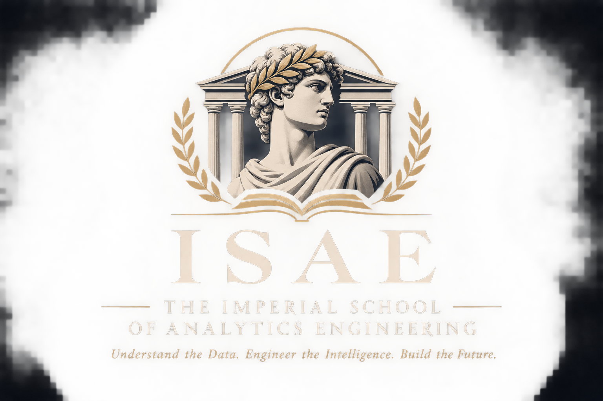

# ISAE — The Imperial School of Analytics Engineering

### Master of Science in Analytics Engineering & Intelligent Data Systems

> **Understand the Data. Engineer the Intelligence. Build the Future.**



---

# 1. Présentation de l'école

## The Imperial School of Analytics Engineering

L'**Imperial School of Analytics Engineering (ISAE)** est une institution académique indépendante dédiée à la formation d'ingénieurs capables de concevoir, développer et faire évoluer des systèmes modernes de données et d'intelligence.

Sa mission est de former des profils capables de maîtriser l'ensemble de la chaîne de valeur de la donnée : de la programmation et de l'algorithmique jusqu'à l'architecture des plateformes analytiques, en passant par les bases de données, la modélisation, les statistiques, la Business Intelligence, le Cloud et l'intelligence artificielle.

L'ISAE ne se limite pas à enseigner l'utilisation d'outils. Elle cherche à développer une véritable capacité d'ingénierie : comprendre un problème, concevoir une solution, la construire, la tester, l'optimiser et être capable de justifier ses choix techniques.

L'école s'inspire des grandes institutions académiques classiques, avec une identité visuelle et intellectuelle inspirée de l'Antiquité grecque : recherche du savoir, rigueur intellectuelle, logique, méthode et excellence.

### Identité académique

| Élément | Description |
|---|---|
| Nom | The Imperial School of Analytics Engineering |
| Acronyme | ISAE |
| Programme | Master of Science in Analytics Engineering & Intelligent Data Systems |
| Durée | 20 mois |
| Organisation | 4 semestres |
| Facultés | 8 |
| Crédits internes | 120 EAC |
| Spécialisation | Analytics Engineering & Intelligent Data Systems |
| Langue du programme | Français, avec documentation technique en anglais |
| Nature | Programme académique indépendant et autodirigé |

L'ISAE est une école indépendante fictive créée dans le cadre d'un parcours d'apprentissage personnel. Les crédits, évaluations, titres et diplômes mentionnés dans ce référentiel sont internes au programme et ne constituent pas des crédits ECTS ni une qualification officiellement accréditée.

---

# 2. La philosophie de l'ISAE

## Une école fondée sur la compréhension, pas sur la mémorisation

L'ISAE repose sur une conviction fondamentale :

**Un ingénieur ne doit pas seulement savoir utiliser une technologie. Il doit comprendre pourquoi elle existe, comment elle fonctionne et dans quelles situations elle doit être utilisée.**

L'objectif n'est donc pas d'accumuler des connaissances théoriques ou de reproduire des tutoriels. Chaque compétence doit pouvoir être mobilisée dans un contexte concret.

La pédagogie de l'école repose sur sept principes.

### I. Intellectual Rigor — La rigueur intellectuelle

Chaque notion doit être comprise en profondeur. Les solutions doivent être justifiées, les raisonnements explicités et les choix techniques argumentés.

### II. Engineering Before Tools — L'ingénierie avant les outils

Les outils évoluent. Les principes d'ingénierie restent.

L'étudiant doit comprendre les algorithmes, les structures de données, les bases de données, les architectures et les systèmes avant de dépendre d'un outil particulier.

### III. Learning by Building — Apprendre en construisant

La théorie doit rapidement devenir pratique.

Chaque semaine donne lieu à un projet. Chaque mois permet de construire une réalisation plus conséquente. Chaque semestre se termine par un projet intégrateur.

### IV. Progressive Difficulty — La difficulté progressive

Le programme suit une progression structurée.

Les premiers enseignements consolident les fondations. Les suivants introduisent des problèmes plus complexes, des contraintes réelles et des architectures plus ambitieuses.

### V. Technical Independence — L'autonomie technique

L'étudiant doit apprendre à chercher, documenter, déboguer, tester et résoudre des problèmes sans dépendre systématiquement d'une solution préexistante.

### VI. Scientific Thinking — La pensée scientifique

Les statistiques, les mathématiques et l'analyse ne sont pas des matières secondaires. Elles permettent de raisonner sur les données, de mesurer les phénomènes et de prendre des décisions fondées sur des preuves.

### VII. Professional Excellence — L'excellence professionnelle

Chaque projet doit être conçu comme une réalisation professionnelle : code maintenable, documentation, tests, architecture cohérente, reproductibilité et présentation claire.

---

# 3. La vision pédagogique

L'ISAE forme un ingénieur polyvalent, mais spécialisé dans l'ingénierie des systèmes de données.

Le programme suit une progression en quatre grandes étapes :

1. **Comprendre et construire :** acquérir les fondations informatiques, algorithmiques et mathématiques.
2. **Structurer et optimiser :** maîtriser les bases de données, les systèmes et les méthodes de résolution de problèmes.
3. **Analyser et industrialiser :** construire des plateformes analytiques fiables et des produits de données.
4. **Architecturer et innover :** concevoir des systèmes distribués, Cloud et augmentés par l'intelligence artificielle.

À la fin du parcours, l'étudiant doit être capable de prendre en charge un projet de données de bout en bout, depuis la compréhension du besoin jusqu'à la mise en production d'une solution exploitable.

---

# 4. Organisation académique

## Une formation de 20 mois en quatre semestres

Le programme est organisé en quatre semestres de cinq mois, représentant chacun 30 crédits académiques internes.

| Semestre | Période | Orientation principale | Crédits |
|---|---|---|---:|
| Semester I | Mois 1 à 5 | Computer Science & Engineering Foundations | 30 EAC |
| Semester II | Mois 6 à 10 | Algorithmic Engineering & Data Systems | 30 EAC |
| Semester III | Mois 11 à 15 | Analytics Engineering & Business Intelligence | 30 EAC |
| Semester IV | Mois 16 à 20 | Cloud, Intelligent Systems & Advanced Engineering | 30 EAC |
| **Total** | **20 mois** | **Master Programme** | **120 EAC** |

Chaque semestre possède :
- des enseignements théoriques et techniques ;
- des journées d'exercices ;
- des projets hebdomadaires ;
- des projets mensuels ;
- des évaluations ;
- un projet intégrateur de fin de semestre.

## Semester I — Computer Science & Engineering Foundations

**Mois 1 à 5 — Construire les fondations de l'ingénieur**

Le premier semestre vise à consolider les compétences fondamentales en informatique et en programmation.

L'objectif n'est pas de passer un temps excessif sur les notions élémentaires déjà connues, mais de développer rapidement une maîtrise solide de Python, de la programmation structurée, de l'algorithmique et des bases de l'ingénierie logicielle.

### Enseignements principaux

- Python avancé et bonnes pratiques de programmation
- Programmation orientée objet
- Structures de données fondamentales
- Algorithmique et complexité
- Récursivité et résolution de problèmes
- Premiers concepts de génie logiciel
- Introduction aux bases de données
- SQL et PostgreSQL
- Fondamentaux mathématiques utiles à l'informatique

### Objectifs du semestre

À la fin de ce semestre, l'étudiant doit pouvoir :
- développer des applications Python structurées ;
- concevoir des programmes orientés objet ;
- choisir des structures de données adaptées ;
- analyser la complexité d'un algorithme ;
- résoudre des problèmes algorithmiques ;
- concevoir une base de données relationnelle ;
- écrire des requêtes SQL fiables ;
- organiser un projet logiciel de manière professionnelle.

### Projet intégrateur

**Semester I Capstone — Engineering Foundations**

Un projet logiciel complet mobilisant Python, la programmation orientée objet, l'algorithmique, les structures de données, les tests et la persistance des données.

---

## Semester II — Algorithmic Engineering & Data Systems

**Mois 6 à 10 — Développer la capacité de résoudre des problèmes complexes**

Le deuxième semestre approfondit les compétences algorithmiques et introduit des systèmes plus élaborés.

L'étudiant ne doit plus seulement être capable d'écrire un programme fonctionnel : il doit savoir concevoir une solution efficace, comparer plusieurs approches et comprendre leurs limites.

### Enseignements principaux

- Algorithmique avancée
- Graphes et algorithmes de parcours
- Programmation dynamique
- Backtracking et recherche
- Optimisation algorithmique
- Structures de données avancées
- Programmation orientée objet avancée
- SQL avancé
- Modélisation relationnelle
- Transactions et intégrité des données
- Statistiques descriptives et probabilités
- Simulation et modélisation de systèmes

### Objectifs du semestre

À la fin de ce semestre, l'étudiant doit pouvoir :
- concevoir et analyser des algorithmes avancés ;
- résoudre des problèmes de graphes ;
- implémenter des moteurs de recherche et de résolution ;
- optimiser des traitements ;
- construire des systèmes logiciels plus complexes ;
- concevoir des modèles de données robustes ;
- maîtriser les requêtes SQL avancées ;
- utiliser les statistiques pour étudier des phénomènes.

### Projet intégrateur

**Semester II Capstone — Algorithmic Systems Engineering**

Un système algorithmique complet intégrant structures de données avancées, résolution de problèmes, optimisation et persistance.

---

## Semester III — Analytics Engineering & Business Intelligence

**Mois 11 à 15 — Transformer les données en produits analytiques**

Le troisième semestre marque le passage vers le cœur de la spécialisation : l'Analytics Engineering.

L'étudiant apprend à concevoir des environnements analytiques modernes, à transformer les données brutes en modèles fiables et à mettre ces données à disposition des équipes métier.

### Enseignements principaux

- Data Warehousing
- Architecture analytique moderne
- ETL et ELT
- dbt et transformation des données
- Modélisation dimensionnelle
- Data Quality et tests
- SQL analytique avancé
- Python pour l'ingénierie des données
- Orchestration des pipelines
- Git et intégration continue
- Statistiques appliquées
- Business Intelligence
- Power BI et Tableau
- Analyse de la performance métier

### Objectifs du semestre

À la fin de ce semestre, l'étudiant doit pouvoir :
- concevoir une architecture analytique ;
- construire un entrepôt de données ;
- développer des pipelines de transformation ;
- utiliser dbt pour structurer les modèles analytiques ;
- mettre en place des tests de qualité ;
- automatiser des traitements ;
- produire des tableaux de bord professionnels ;
- transformer une problématique métier en indicateurs pertinents.

### Projet intégrateur

**Semester III Capstone — Modern Analytics Platform**

Construction d'une plateforme analytique complète, de l'ingestion des données à la restitution métier, avec modélisation, transformations, tests, documentation et visualisation.

---

## Semester IV — Cloud, Intelligent Systems & Advanced Engineering

**Mois 16 à 20 — Concevoir des architectures modernes et intelligentes**

Le dernier semestre est consacré à l'architecture, à la scalabilité et aux technologies avancées.

L'objectif est de dépasser la construction de pipelines isolés pour comprendre comment concevoir des plateformes de données complètes, évolutives et capables d'intégrer des fonctionnalités d'intelligence artificielle.

### Enseignements principaux

- Cloud Computing
- Architecture sur Google Cloud Platform
- Data Lakes et Lakehouse
- Systèmes distribués
- Traitement de données à grande échelle
- Orchestration avancée
- CI/CD et déploiement
- Monitoring et observabilité
- Sécurité et gouvernance des données
- Machine Learning appliqué
- Large Language Models
- Retrieval-Augmented Generation (RAG)
- Applications analytiques augmentées par l'IA
- Architecture de plateformes de données

### Objectifs du semestre

À la fin de ce semestre, l'étudiant doit pouvoir :
- concevoir une architecture Cloud ;
- déployer des solutions analytiques ;
- comprendre les enjeux des systèmes distribués ;
- construire des pipelines industrialisés ;
- surveiller et maintenir des systèmes ;
- intégrer des modèles d'intelligence artificielle ;
- concevoir des applications exploitant des données et des LLM ;
- prendre des décisions d'architecture argumentées.

### Projet final

**Imperial Graduation Project — Intelligent Data Systems**

Un projet de fin de cursus démontrant la maîtrise des compétences acquises pendant les quatre semestres.

Il doit prendre la forme d'une solution complète, documentée, testée, reproductible et présentable dans un portfolio professionnel.

---

# 5. Les huit facultés de l'ISAE

L'enseignement est organisé autour de huit facultés complémentaires.

Chaque faculté représente un domaine de compétence. Les enseignements peuvent être répartis sur plusieurs semestres afin de construire une progression cohérente.

## Faculty I — Computer Science & Software Engineering

**La science informatique et le génie logiciel**

Cette faculté développe les fondations nécessaires à la conception de logiciels robustes.

Domaines étudiés :
- Python ;
- programmation structurée ;
- programmation orientée objet ;
- architecture logicielle ;
- tests et débogage ;
- conception modulaire ;
- Git et gestion de versions ;
- bonnes pratiques de développement.

## Faculty II — Data Structures & Algorithmic Engineering

**Structures de données et ingénierie algorithmique**

Cette faculté développe la capacité à concevoir des solutions efficaces.

Domaines étudiés :
- listes, piles et files ;
- dictionnaires et ensembles ;
- arbres et graphes ;
- récursivité ;
- tri et recherche ;
- complexité temporelle et spatiale ;
- programmation dynamique ;
- backtracking ;
- optimisation.

## Faculty III — Algorithmic Project Studio & Simulation

**Atelier de conception algorithmique et simulation**

Cette faculté transforme les connaissances algorithmiques en réalisations concrètes.

Les projets peuvent notamment inclure :
- Maze Generator & Solver ;
- Pathfinding Engine ;
- Sudoku Solver ;
- Game of Life ;
- Simplified Chess Engine ;
- simulations de systèmes ;
- moteurs de recherche et de résolution.

## Faculty IV — Database Engineering & SQL

**Ingénierie des bases de données**

Cette faculté développe la maîtrise du stockage, de la modélisation et de l'interrogation des données.

Domaines étudiés :
- SQL ;
- PostgreSQL ;
- modélisation relationnelle ;
- normalisation ;
- indexation ;
- jointures et agrégations ;
- transactions ;
- optimisation des requêtes ;
- conception de schémas ;
- intégrité des données.

## Faculty V — Analytics Engineering

**Ingénierie analytique**

Cœur de la spécialisation, cette faculté apprend à construire des systèmes qui transforment les données en ressources analytiques fiables.

Domaines étudiés :
- Data Warehousing ;
- ETL et ELT ;
- dbt ;
- modélisation dimensionnelle ;
- Data Quality ;
- pipelines de données ;
- orchestration ;
- documentation des modèles ;
- CI/CD analytique.

## Faculty VI — Mathematics, Statistics & Applied Science

**Mathématiques, statistiques et sciences appliquées**

Cette faculté apporte les outils scientifiques nécessaires à l'analyse et à la compréhension des données.

Domaines étudiés :
- algèbre et mathématiques discrètes ;
- logique ;
- probabilités ;
- statistiques descriptives ;
- distributions ;
- inférence statistique ;
- corrélation et régression ;
- simulation ;
- analyse quantitative.

## Faculty VII — Business Analytics & Business Intelligence

**Analyse métier et intelligence décisionnelle**

Cette faculté développe la capacité à transformer les données en informations utiles à la décision.

Domaines étudiés :
- KPI et indicateurs ;
- analyse métier ;
- storytelling avec les données ;
- Power BI ;
- Tableau ;
- visualisation ;
- dashboards ;
- analyse de performance ;
- communication des résultats.

## Faculty VIII — Cloud, Architecture & AI-Augmented Analytics

**Cloud, architecture et analytique augmentée par l'intelligence artificielle**

Cette faculté prépare à la conception de plateformes modernes et évolutives.

Domaines étudiés :
- Cloud Computing ;
- Google Cloud Platform ;
- Data Lakes et Lakehouse ;
- systèmes distribués ;
- architecture de données ;
- sécurité et gouvernance ;
- Machine Learning ;
- LLM ;
- RAG ;
- applications intelligentes.

---

# 6. Organisation du travail : jours, semaines et mois

Le cursus est conçu pour garantir une progression régulière, mesurable et vérifiable.

## Les journées académiques

Une journée classique comprend **10 exercices**, répartis selon trois niveaux de difficulté.

| Niveau | Nombre | Objectif |
|---|---:|---|
| Easy | 3 | Compréhension et application des fondamentaux |
| Intermediate | 4 | Résolution de problèmes et autonomie |
| Advanced | 3 | Raisonnement approfondi et complexité |
| **Total** | **10** | **10 exercices par journée classique** |

Les exercices ne doivent pas être de simples répétitions. Ils doivent progressivement mobiliser plusieurs compétences et encourager la réflexion.

Une journée peut également comprendre :
- un cours théorique ;
- des exemples expliqués ;
- des exercices pratiques ;
- un contrôle de connaissances ;
- une correction détaillée ;
- une synthèse des notions étudiées.

Les journées dédiées à un examen, à un projet ou à une révision peuvent avoir un format spécifique. La règle des 10 exercices concerne les journées classiques d'apprentissage.

## Les projets hebdomadaires

Chaque semaine comprend un projet pratique.

Ces projets permettent de mettre immédiatement en application les notions étudiées.

Ils sont généralement plus courts que les projets mensuels, mais doivent être suffisamment complets pour produire un résultat concret.

Chaque projet hebdomadaire doit comporter :
- un objectif précis ;
- un énoncé ;
- des contraintes techniques ;
- des critères de réussite ;
- des livrables ;
- une évaluation ;
- une correction ou une revue technique.

## Les projets mensuels

Chaque mois comprend un projet plus important, conçu pour mobiliser plusieurs compétences.

Ces projets constituent progressivement un portfolio de réalisations techniques.

Ils doivent être documentés et organisés dans le dépôt GitHub de l'ISAE.

## Les projets majeurs

En complément des projets hebdomadaires et mensuels, le cursus comprend quatre projets intégrateurs de semestre.

Ils demandent davantage de conception, d'autonomie et de profondeur technique.

Ils servent à vérifier que les connaissances ne sont pas simplement acquises séparément, mais peuvent être mobilisées dans un système complet.

## Le projet de graduation

Le dernier projet constitue l'aboutissement du cursus.

Il doit démontrer la capacité à :
- comprendre un besoin ;
- définir une architecture ;
- concevoir les modèles de données ;
- développer les composants ;
- construire les pipelines ;
- tester et contrôler la qualité ;
- déployer une solution ;
- documenter les choix techniques ;
- présenter et défendre le résultat.

---

# 7. Les vingt projets mensuels

Les projets mensuels sont répartis sur les quatre semestres.

Ils représentent une progression technique, depuis les premières applications jusqu'aux plateformes analytiques avancées.

| Mois | Projet | Domaine |
|---:|---|---|
| 01 | Python Analytics Toolkit | Python |
| 02 | Sorting Visualizer | Algorithmique |
| 03 | Object-Oriented Management System | Génie logiciel |
| 04 | SQL Analytics Laboratory | SQL |
| 05 | Maze Generator & Solver | Algorithmique |
| 06 | Inventory Management System | Modélisation et SQL |
| 07 | Pathfinding Engine | Graphes |
| 08 | Sudoku Solver & Constraint Engine | Backtracking |
| 09 | Advanced SQL Laboratory | SQL avancé |
| 10 | Discrete Simulation Engine | Statistiques et simulation |
| 11 | Modern Analytics Warehouse | Data Warehousing |
| 12 | E-commerce Analytics Platform | Analytics Engineering |
| 13 | Customer Intelligence System | Analyse client |
| 14 | Executive BI Platform | Business Intelligence |
| 15 | Production Analytics Pipeline | Industrialisation |
| 16 | Cloud Analytics Architecture | Cloud |
| 17 | Scalable Data Platform | Architecture distribuée |
| 18 | AI-Powered Analytics Application | Intelligence artificielle |
| 19 | Advanced Analytics Engineering Project | Architecture analytique |
| 20 | Imperial Graduation Project | Projet final |

Chaque projet devra posséder son propre README, son code source, ses éventuels jeux de données, ses tests, sa documentation technique et une présentation du résultat.

Les projets hebdomadaires restent distincts de ces vingt projets mensuels.

---

# 8. Évaluations et validation académique

L'ISAE utilise un système d'évaluation destiné à mesurer la compréhension, la capacité de réalisation et l'autonomie technique.

## Évaluation des journées

Les exercices sont corrigés et suivis afin de mesurer :
- le taux de réussite ;
- le temps de résolution ;
- la difficulté rencontrée ;
- les notions maîtrisées ;
- les notions à retravailler.

## Évaluation des projets

Chaque projet est évalué selon plusieurs dimensions :
- fonctionnement ;
- qualité du code ;
- architecture ;
- respect des contraintes ;
- tests ;
- documentation ;
- capacité à expliquer les choix réalisés.

## Examens de validation

Des évaluations sont organisées à différents niveaux du cursus :
- contrôles de connaissances ;
- examens pratiques ;
- examens de fin de module ;
- examens de fin de semestre ;
- soutenance du projet final.

## Barème de référence

| Critère | Pondération |
|---|---:|
| Exercices et travaux pratiques | 25 % |
| Projet de validation | 35 % |
| Examen pratique individuel | 30 % |
| Explication et justification technique | 10 % |
| **Total** | **100 %** |

Le seuil de validation de référence est fixé à **80/100**.

Une bonne note ne doit pas uniquement refléter un résultat fonctionnel. La compréhension et la capacité à justifier les décisions techniques sont également essentielles.

---

# 9. Système de progression et statistiques

L'ISAE utilise un système de suivi interne permettant de visualiser précisément l'évolution de l'étudiant.

Le suivi ne doit pas se limiter à une note générale. Il doit permettre d'identifier les forces, les faiblesses et les axes d'amélioration.

## Statistiques académiques

Les indicateurs suivis comprennent notamment :

- jours terminés ;
- exercices réalisés ;
- exercices réussis ;
- taux de réussite global ;
- taux de réussite par difficulté ;
- moyenne générale ;
- notes par faculté ;
- progression par semestre ;
- projets terminés ;
- projets validés ;
- examens réussis ;
- compétences acquises ;
- temps consacré aux exercices ;
- notions à réviser.

## Progression par compétence

Chaque compétence doit posséder un statut de maîtrise.

Exemple de niveaux :

| Niveau | Signification |
|---|---|
| 0 — Not Introduced | Notion non étudiée |
| 1 — Introduced | Notion découverte |
| 2 — Practicing | Notion en cours d'apprentissage |
| 3 — Operational | Notion maîtrisée en pratique |
| 4 — Advanced | Notion maîtrisée sur des problèmes complexes |
| 5 — Expert | Capacité à concevoir, optimiser et expliquer |

La progression doit être fondée sur des réalisations et des évaluations, pas uniquement sur le nombre de jours terminés.

## XP et niveaux

Un système de points d'expérience peut compléter le suivi académique.

Les XP récompensent :
- les exercices réussis ;
- les projets terminés ;
- les examens validés ;
- les défis avancés ;
- la régularité ;
- la qualité des livrables.

Les XP sont un indicateur de progression et de motivation. Ils ne remplacent jamais les notes académiques ni les critères de validation.

---

# 10. Les crédits académiques internes

Le programme représente 120 crédits internes, appelés **EAC — Engineering Academic Credits**.

| Semestre | Crédits |
|---|---:|
| Semester I | 30 EAC |
| Semester II | 30 EAC |
| Semester III | 30 EAC |
| Semester IV | 30 EAC |
| **Total** | **120 EAC** |

Ces crédits représentent la structure interne du cursus. Ils ne correspondent pas à une reconnaissance officielle ou à des crédits ECTS.

L'obtention des crédits d'un semestre dépend de la validation de ses enseignements, projets et évaluations selon les règles académiques du programme.

---

# 11. Compétences visées à la sortie

À l'issue du programme, l'étudiant devra avoir développé des compétences dans les domaines suivants.

### Software Engineering
- Python avancé ;
- programmation orientée objet ;
- conception logicielle ;
- tests et qualité du code ;
- architecture et modularité.

### Algorithmic Engineering
- structures de données ;
- algorithmique avancée ;
- analyse de complexité ;
- graphes ;
- optimisation ;
- simulation.

### Database Engineering
- SQL avancé ;
- PostgreSQL ;
- modélisation relationnelle ;
- optimisation ;
- gestion des transactions.

### Analytics Engineering
- Data Warehousing ;
- ETL et ELT ;
- dbt ;
- modélisation dimensionnelle ;
- pipelines ;
- Data Quality ;
- orchestration.

### Statistics & Applied Analytics
- probabilités ;
- statistiques ;
- analyse quantitative ;
- simulation ;
- interprétation des résultats.

### Business Intelligence
- KPI ;
- Power BI ;
- Tableau ;
- dashboards ;
- analyse métier ;
- communication des résultats.

### Cloud & Intelligent Systems
- Cloud Computing ;
- architecture de données ;
- systèmes distribués ;
- déploiement ;
- LLM ;
- RAG ;
- intégration de l'IA.

---

# 12. Portfolio et standards de qualité

Chaque projet doit être traité comme une réalisation professionnelle.

Le dépôt GitHub doit permettre à un lecteur externe de comprendre rapidement :
- le problème traité ;
- les objectifs ;
- les choix techniques ;
- l'architecture ;
- le fonctionnement ;
- les résultats ;
- les limites éventuelles.

## Standards attendus

Chaque projet important doit, lorsque cela est pertinent, contenir :

- un README détaillé ;
- une structure de fichiers claire ;
- un code propre et modulaire ;
- des tests ;
- des instructions d'installation ;
- des instructions d'exécution ;
- des exemples d'utilisation ;
- des diagrammes d'architecture ;
- une documentation technique ;
- des captures d'écran ou démonstrations.

Le portfolio final doit montrer une progression cohérente et une véritable capacité à concevoir des systèmes.

---

# 13. Projet de graduation — Imperial Graduation Project

Le projet final est la réalisation la plus importante du cursus.

Il doit mobiliser les compétences acquises dans les huit facultés et démontrer une maîtrise globale de l'ingénierie des données.

Il peut prendre la forme d'une plateforme analytique intelligente intégrant :

- une ingestion de données ;
- une architecture de stockage ;
- des modèles de données ;
- des transformations analytiques ;
- des contrôles de qualité ;
- des pipelines automatisés ;
- une infrastructure Cloud ;
- des tableaux de bord ;
- des fonctionnalités d'intelligence artificielle ;
- une documentation complète.

Le projet doit être défendable techniquement : chaque décision importante doit pouvoir être expliquée, justifiée et comparée à des alternatives.

La validation du projet final constitue la dernière étape du parcours académique.

---

# 14. Organisation du dépôt GitHub

Le dépôt central de l'ISAE doit servir de référentiel académique et technique.

Structure recommandée :

```text
ISAE/
│
├── README.md
│
├── assets/
│   ├── logo/
│   ├── identity/
│   └── diagrams/
│
├── curriculum/
│   ├── PROGRAM_OVERVIEW.md
│   ├── ACADEMIC_PHILOSOPHY.md
│   ├── FACULTIES.md
│   ├── SEMESTER_I.md
│   ├── SEMESTER_II.md
│   ├── SEMESTER_III.md
│   ├── SEMESTER_IV.md
│   └── ASSESSMENT_SYSTEM.md
│
├── courses/
│   ├── faculty-I/
│   ├── faculty-II/
│   ├── faculty-III/
│   ├── faculty-IV/
│   ├── faculty-V/
│   ├── faculty-VI/
│   ├── faculty-VII/
│   └── faculty-VIII/
│
├── projects/
│   ├── weekly/
│   ├── monthly/
│   ├── semester-capstones/
│   └── graduation-project/
│
├── academic-records/
│   ├── PROGRESS.md
│   ├── GRADES.md
│   ├── SKILLS.md
│   ├── XP.md
│   └── PROJECTS.md
│
└── resources/
    ├── references/
    ├── documentation/
    └── datasets/
```

Le README principal présente l'institution et son fonctionnement. Les fichiers du dossier `curriculum/` détaillent les enseignements et les règles académiques. Les projets, les exercices et les statistiques disposent de leurs propres espaces.

---

# 15. Les valeurs de l'ISAE

L'ISAE ne cherche pas à former des utilisateurs d'outils ou des exécutants.

Elle cherche à former des ingénieurs capables de penser, de construire et de faire évoluer des systèmes.

Son ambition repose sur trois idées :

**Understand.** Comprendre les fondements scientifiques et techniques.

**Engineer.** Concevoir des solutions robustes, efficaces et maintenables.

**Innovate.** Utiliser les connaissances acquises pour construire les systèmes de demain.

---

<p align="center">

**THE IMPERIAL SCHOOL OF ANALYTICS ENGINEERING**

*Understand the Data. Engineer the Intelligence. Build the Future.*

**ISAE — 120 EAC · 4 Semesters · 20 Months**

</p>
